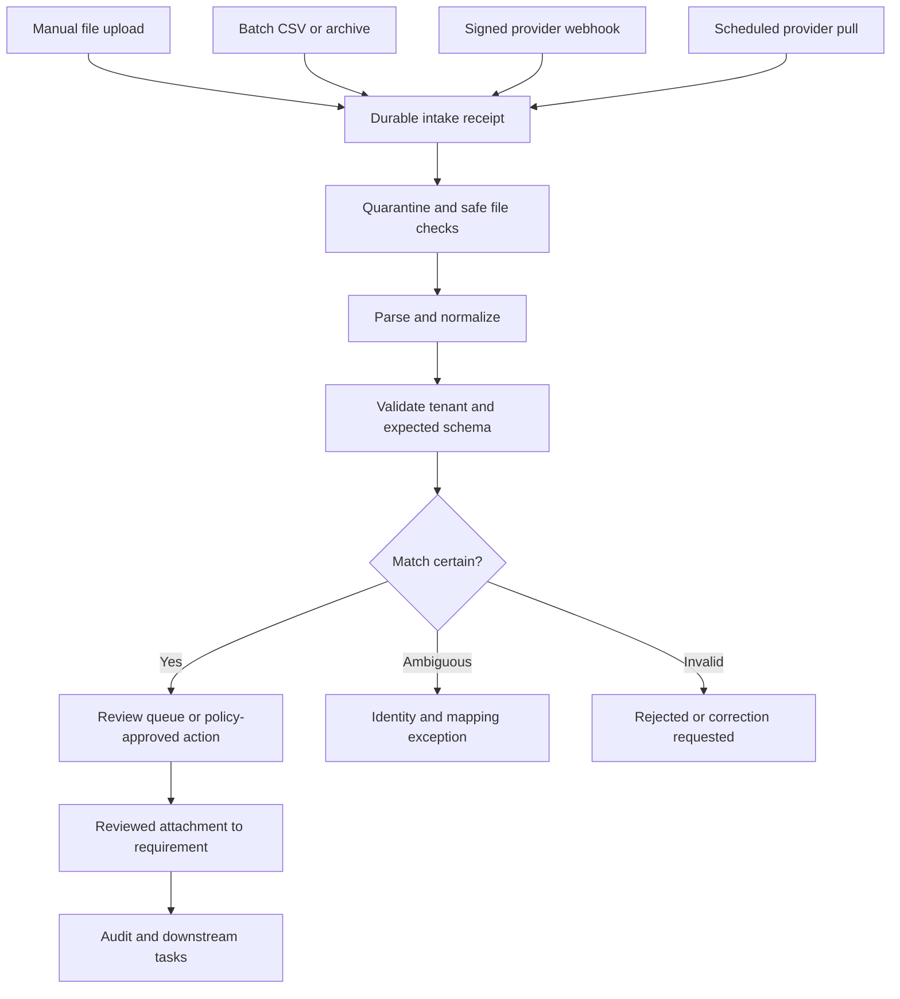
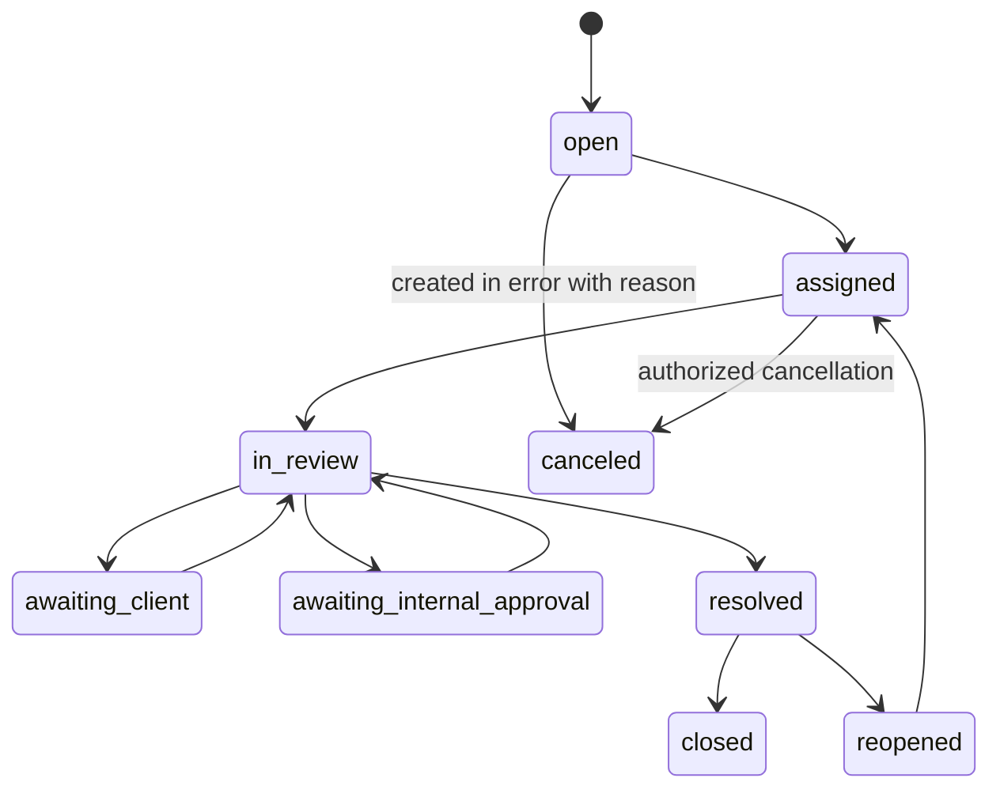

# QUALIFYFLOW
## 03 — Workflows, User Journeys & Operational State Machines

**Document status:** Product workflow specification v1.0  
**Date:** 2026-11-17  
**Product:** QualifyFlow — multi-tenant driver qualification and managed compliance operations platform  
**Intended readers:** Product owner, compliance operations, engineering, QA, integration developers, and Codex  
**Companion plans:** `01_QUALIFYFLOW_SOFTWARE_MASTER_PLAN.md` · `02_DESIGN_AND_MOTION_SYSTEM_v1.1.md` · `04_SECURITY_COMPLIANCE_AND_DELIVERY.md` (planned)

> **Product boundaries.** This specifies functional workflows for a real commercial-intent software product, **not** a nonfunctional interview demo. It is based on our independent product concept and the responsibilities in the CrewBloom job posting, **not** any undisclosed client system. All companies, people, provider events, report formats, thresholds, and policies used as examples are synthetic. Specific DOT/FMCSA/49 CFR Part 391 requirements, background screening laws, retention obligations, adverse-action steps, and legally binding qualification decisions require authoritative research and review under Document 04 before production use. QualifyFlow must not equate an uploaded document with a legally qualified driver.

---

# 1. What this document owns

Document 01 says **what** QualifyFlow is. Document 02 says **how it looks and moves**. This document says **exactly what happens** when a person or external system uses it.

It is the behavioral contract for:

- Company onboarding, branch administration, service mode, account creation, invitations, and user access.
- Service-provider staff assignment to a client.
- Screening-provider and customer API connection setup, credential lifecycle, mapping, webhooks, and synchronization.
- Driver registration, historical company engagement, transfers, and duplicate resolution.
- Inbound report/document intake by manual upload, batch/CSV, API, webhook, and scheduled pull.
- Safe person/company/requirement matching; document verification, evidence versions, and controlled acceptance.
- Missing/expired/incomplete-item detection; specialist review; cases, tasks, approvals, and follow-ups.
- Client-specific correspondence, authorized notifications, delivery outcomes, and escalation.
- Scheduling, automation, replay/recovery, audit history, and both customer operating models.
- Happy paths, alternate paths, failures, state machines, action-level authorization, and acceptance scenarios.

**Outside this document:** final regulatory rule tables; security threat model; legally valid retention schedules; production infrastructure and incident plans; full visual styling, layout measurements, and motion tokens. Those belong to Documents 04 and 02 respectively.

## 1.1 Foundational product principles

1. **An incoming file is not yet a verified qualification record.** Preserve source, match, review, and attachment as separate actions.
2. **A company is not a branch; a driver identity is not a user account; a driver is not a single permanent employer engagement.**
3. **One company must never see another company's data**, regardless of URL guessing, request editing, background jobs, or accidental provider mapping.
4. **Managed work does not remove employer-reserved responsibilities.** An authorized client representative retains decisions assigned to them by law, contract, and approved procedures.
5. **No silent success.** Every intake, notification, import, connection test, and job must honestly report its stage and outcome.
6. **Automation proposes, verifies, and routes; it does not improvise compliance decisions.** Uncertain identity matches and restricted decisions wait for authorized human review.
7. **Reprocessing must be safe.** One provider event or CSV item can be retried without creating duplicate accepted records or duplicate notifications.
8. **Every material action leaves a trace**, including who acted, what changed, which client it affected, when, under what rules, and why.
9. **Support high-volume work without sacrificing accuracy.** Bulk operations still return per-item decisions and errors.
10. **No fake product behavior.** Settings persist, access checks run server-side, notifications have delivery outcomes, and APIs have tested endpoints.

## 1.2 Requirement language

- **MUST:** necessary for the described workflow to be considered implemented.
- **SHOULD:** strongly recommended, may be postponed with a documented reason.
- **MAY:** optional extension.
- **Pending policy:** cannot be asserted as an actual regulatory rule until verified in Document 04.

---

# 2. Actors, responsibility, and operating modes

## 2.1 Actor catalog

| Actor | Responsibilities | Typical access |
|---|---|---|
| Platform owner | Product-level configuration, plan/service provisioning, exceptional support | Platform admin, with sensitive data access constrained and audited |
| Service administrator | Create clients, assign specialists, configure client service delivery | Assigned/authorized client administration |
| Compliance specialist | Receive/verify reports, attach evidence, review exceptions, request information, perform permitted corrections | Operations console, assigned clients only |
| Compliance reviewer/team lead | Oversee queues, approve specialist actions, handle ambiguous and elevated cases | Scoped operations console and approval powers |
| Integration administrator | Configure client-scoped provider/API connections, secrets, mappings, health and replay | Scoped integration controls; no unrestricted document visibility |
| Client company administrator | Manage own organization users, submit records, authorize provider access, respond to approvals | Own tenant, permitted branches |
| Client contributor | Provide documents and answer requests; may not approve restricted decisions | Limited own tenant/branch |
| Client viewer/auditor | View explicitly permitted status, evidence and audit exports | Read-only within authorized scope |
| Background screening provider | Sends structured results, documents, callbacks, status changes | Machine identity with constrained scopes and client binding |
| Automation worker | Executes tenant-scoped scheduled/event-driven tasks | Service identity with narrow permissions and audit identity |
| Driver/applicant | Subject of the records, not necessarily an authenticated user | A separate secure driver-facing journey only if intentionally built later |

## 2.2 Service modes

| Mode | Routine processing | Client's involvement | Routing |
|---|---|---|---|
| `self_service` | Client staff do intake, document review, approved record administration | Primary operator | Assign tasks to client staff; service provider only if contracted support permits |
| `managed` | Service-provider specialist does routine intake and verification | Supplies documents, authorizes connections, receives escalations, makes reserved decisions | Route intake and exceptions to assigned specialists; client gets requests and reviews |
| `hybrid` | Shared by explicit per-workflow configuration | Joint, based on agreed owner | Task types use versioned ownership policy |

Service mode is not a shortcut around permission checks. A client can change mode only through an audited, authorized configuration transition that handles active work in progress.

## 2.3 Authority vs. participation matrix

| Action | Specialist | Client admin | Reviewer | Integration admin |
|---|---|---|---|---|
| Read assigned incoming results | Yes, scoped | Own tenant if enabled | Yes, scoped | Metadata only where necessary |
| Create company account | Onboarding roles only | No cross-tenant creation | No by default | No |
| Invite client user | As granted and approved | Within own tenant | Only if granted | No |
| Change roles | Limited, audited | Limited to allowed roles | May review escalation | Integration-specific scopes only |
| Upload file | Yes, scoped | Yes, own tenant | Yes if permitted | No by default |
| Accept unambiguous matched evidence | If policy allows | If self-service permissions allow | Yes, scoped | No |
| Resolve ambiguous identity match | Requires verified basis and authority | Can provide confirmation | Review if required | No |
| Approve employer-reserved decision | No | Only designated authorized employer representative | Cannot substitute for employer | No |
| Send approved notification | Within client policy | For own tenant as granted | Approve sensitive sends | No |
| Configure provider credentials | No unless separately authorized | Authorize and initiate as allowed | No | Yes, scoped |
| Override a policy-blocked action | No by default | No by default | Limited review process; never bypass legal rules | No |

**Implementation note:** These are capability examples, not a final fixed matrix. Persist granular permissions and service ownership; enforce them in API policy checks. Explicit approvals can be required even when someone has the technical capability to perform an action.

---

# 3. Workflow infrastructure: shared conventions

## 3.1 Identity and scope on every request

Each command and durable record should be attributable to:

```text
actor_id | actor_type | client_tenant_id | optional branch_scope
resource_id | resource_version | policy_version | request_id
correlation_id | idempotency_key (where appropriate) | occurred_at (UTC)
```

- The backend resolves allowed tenant/branch scope from authenticated user membership or signed machine credentials.
- A client ID in the path or payload **selects** a target; it does **not grant access**.
- API responses expose only minimum data necessary for the role. Never put raw identity numbers or health/screening contents in URLs or normal logs.
- Timestamps are stored in UTC; user-facing due dates use the client-configured timezone and display the timezone explicitly.
- Stateful updates use optimistic locking (`version`, ETag, or comparable) to prevent two reviewers silently overwriting one another.
- Commands changing multiple linked objects (e.g., attach evidence + create review + audit entry) should commit atomically where possible.

## 3.2 Command vs. event

**Command:** intent issued by user or worker, such as `AttachReportToRequirement`. The server validates scope, current state, inputs, and the operator's authority.

**Domain event:** factual successful transition, such as `ReportAttached`, emitted after commit. Downstream notifications and automations consume events through a transactional outbox or equivalent reliable mechanism.

A command can fail without emitting an event. An event must be traceable to committed state, not merely to an optimistic browser animation.

## 3.3 Shared UI action responses

Every consequential operation returns one of:

- **Completed:** persisted change, new state, human-readable outcome, reference ID.
- **Pending:** accepted async job with durable status/poll or event subscription.
- **Needs review:** ambiguity, missing evidence, unsupported policy, or required approval.
- **Rejected:** validation/authorization failure with safe, actionable reason.
- **Retryable failure:** transient problem, no false completion, recovery method.

A button cannot announce “success” merely because the request started. Presentation and transitions follow Document 02.

## 3.4 Cross-cutting event examples

`tenant.created`, `tenant.activated`, `user.invited`, `membership.revoked`, `integration.configured`, `integration.tested`, `integration.disabled`, `driver.engagement_created`, `intake.received`, `intake.match_proposed`, `intake.flagged`, `document.uploaded`, `document.reviewed`, `document.attached`, `requirement.flagged`, `exception.opened`, `approval.requested`, `approval.decided`, `notification.queued`, `notification.delivered`, `notification.failed`, `automation.executed`, `export.completed`.

Every event definition includes schema version, tenant, source, recorded time, actor, and correlation ID. Event names alone do not authorize operations.

## 3.5 Universal state guardrails

- State changes must be explicit commands, not arbitrary updates to a `status` column.
- Finalized source evidence is immutable or versioned; a correction creates a new version/review.
- Don't use a single flag called `compliant` to mix document completeness, worker review, legal qualification, and client authorization.
- Status can be “unknown,” “blocked,” or “unreviewed”; never auto-convert uncertainty to “clear.”
- A revoked user cannot complete pending approvals from cached browser state.
- Pending actions survive page refresh; the server is the authority.

---

# 4. End-to-end product journey map

| ID | Journey | Primary actor | Starts when | Ends when |
|---|---|---|---|---|
| J01 | Client company onboarding | Service admin | New client authorized | Tenant configured and activated |
| J02 | User account creation and access | Client/service admin | User needs access | Invitation accepted, correct scoped role active |
| J03 | Service team assignment and handoff | Service admin | Tenant needs managed service | Specialist owns queued tasks |
| J04 | Screening API setup | Integration admin + client approver | Provider access requested | Verified sandbox/production connection active |
| J05 | Client API key/service account | Client admin + integration admin | Customer wishes to integrate | Scoped key issued and tested |
| J06 | Driver registration and branch/engagement changes | Specialist or client contributor | New/updated driver | Correct identity and engagement preserved |
| J07 | Manual document submission | Specialist/client | Document received | Evidence securely stored in review queue |
| J08 | Provider result intake | System/provider | API/webhook/pull result arrives | Intake item ready for match/validation |
| J09 | Batch/CSV import | Specialist | Approved file uploaded | Per-row outcome report and exceptions |
| J10 | Driver and requirement matching | Specialist/reviewer | Intake item ready | Verified link or actionable unresolved state |
| J11 | Document review and versioning | Specialist/reviewer | Evidence is matched | Reviewed attachment/rejection recorded |
| J12 | Missing/expired exception lifecycle | Worker/specialist | Rule or reviewer flags issue | Resolved/closed with trace |
| J13 | Client approval and escalation | Client authorized approver | Decision required | Decision and downstream tasks recorded |
| J14 | Notifications and customer correspondence | Worker/specialist | Approved communication triggered | Delivery/failed/suppressed outcome known |
| J15 | Automation scheduling and execution | Service admin/worker | Rule enabled/event fires | Run completed/failed with audit |
| J16 | Client portal request fulfillment | Client user | Requires submission/approval | Action verified and routed back |
| J17 | Integration failure and recovery | Ops/integration admin | Sync test/pull/webhook fails | Safely retried or manually resolved |
| J18 | Reporting, exports, and audit | Authorized operator/client | Review or audit request | Authorized output/review record produced |
| J19 | Suspension/offboarding | Service/client admin | Client stops service | Access suspended, records handled under approved policy |

The flows below are **product requirements**, not just user stories. Every applicable journey must be covered in API, persistence, authorization, audit, and QA.

---

# 5. J01 — Client company onboarding, branches, and service mode

## 5.1 Business goal

An approved service administrator must create a real client company in the platform, configure its operational service and contacts, and allow the right users to access it. A company can have multiple branches without accidentally creating multiple unrelated tenants.

## 5.2 Required inputs

- Legal and display names; internal customer reference (unique in provider context).
- Service mode (`managed`, `self_service`, `hybrid`) and effective date.
- Client timezone; region/jurisdiction metadata for later verified rule applicability.
- Designated account owner and client primary contact.
- Optional branches/divisions with stable, tenant-owned IDs.
- Client-approved responsibility/notification/approval policy version.
- Named service-team assignment where managed services apply.
- Required onboarding configuration checklist and status.

**Avoid collecting sensitive driver details during account creation.** Driver onboarding is a separate journey.

## 5.3 Happy path

1. Authorized service admin selects **Create company**.
2. Backend validates uniqueness, legal organization fields, actor authorization, and company status.
3. Tenant is created as `draft`; audit `tenant.created` is recorded.
4. Admin adds initial branches; system guarantees each branch belongs to that tenant.
5. Admin selects service mode and configures who performs intake, reviews, and client approvals.
6. Admin assigns service team and primary owner; system verifies assignment eligibility.
7. Admin sets contact and notification policy, with any required client approval pending.
8. Admin invites client administrator (J02), configures integration prerequisites (J04), and verifies readiness checklist.
9. Admin opens a **Review configuration** summary of actual stored settings.
10. System permits `activate` only after mandatory prerequisites are satisfied; records activator, version, effective time.
11. A genuine active tenant appears in permitted client lists and is isolated from all other tenants.

## 5.4 State machine

```text
draft ──> configuring ──> ready_for_review ──> active
  │           │                    │             │
  └──────────> archived_draft      └──> configuring
                                               │
                                        suspended ──> active
                                               │
                                       offboarding ──> closed
```

`closed` is operational service closure, **not automatic data erasure**. Suspended tenants cannot accept new unattended intake or issue new invitations unless explicitly permitted by suspension policy; approved retention and retrieval obligations still apply.

## 5.5 Failure and alternate paths

- Duplicate legal name is not a reliable sole matching criterion; use stable customer references and review similar organizations.
- Failed invitation does not roll back the company; onboarding stays incomplete with retry.
- Company branch `B` cannot attach to tenant `A` by manipulating IDs.
- Switching to `managed` with no specialist blocks activation.
- A pending intake item during a service-mode switch is retained with its existing owner until an audited handoff is completed.
- A withdrawn onboarding request archives the draft; no in-flight invitation or credential remains valid.

## 5.6 Acceptance tests

- Two companies with overlapping branch names remain separate.
- Incomplete onboarding cannot be marked active through UI or REST.
- Company creation produces real persistent tenant and audit record.
- Suspended client API keys are appropriately restricted; no accepted intake silently bypasses suspension.

---

# 6. J02/J03 — User accounts, invitations, permissions, service assignments

## 6.1 Important distinction

- **Platform login user**: staff member who authenticates to QualifyFlow.
- **Client-company membership**: which company/branches a login user may access.
- **Service-provider assignment**: which client companies a specialist may work on.
- **Driver record**: subject of qualification evidence; not automatically a login.

## 6.2 Invite and activation journey

1. Authorized admin selects **Invite user** in a particular tenant context.
2. System shows allowed roles, scopes (whole tenant or specified branches), and relevant permissions.
3. Admin provides email and chosen role; backend validates no privilege escalation or cross-tenant assignment.
4. Generate time-limited single-use invite token; store only a protected token representation.
5. Send invitation through transactional email and log send outcome.
6. Recipient opens invite, authenticates/creates login, completes required identity and MFA checks.
7. Recipient accepts invite; server atomically establishes scoped membership and marks invite `accepted`.
8. Membership is active only after all approval and account prerequisites are met.
9. User sees only allowed clients/branches; account status and grant are auditable.

### Invitation state

`draft → queued → sent → accepted` with alternate `send_failed`, `expired`, `revoked`. Resending issues a new controlled token; previous acceptance cannot be replayed.

### Membership state

`pending → active → suspended → active` or `active → revoked`. Revocation must prevent subsequent API calls, even if UI remains open.

## 6.3 Service assignment journey

1. Service admin picks assigned client and eligible specialist/team.
2. Assignment defines active dates, role, queue ownership, and allowable client branches.
3. System determines which existing unassigned intake/exception tasks need reassignment.
4. Admin previews impact and confirms.
5. Audit old/new owner; route notifications and tasks to new owner.
6. Former specialist loses access when grant ends unless another valid grant remains.

## 6.4 User-management failure paths

- Duplicate pending invite: show existing invitation; allow revoke/resend without creating extra memberships.
- Revoked/expired invitation: deny acceptance and provide a safe path to request a fresh invite.
- Self-promotion attempt: deny in backend; log security event without leaking other tenant information.
- Removed administrator: require another authorized admin or defined recovery path rather than orphaning the tenant.
- Different emails for same person: no automatic account merge based on display name.
- Assigned task owner revoked: move tasks to supervisor/unassigned queue, preserving history.
- Session expires while drafting: preserve non-sensitive draft safely where permitted; force reauthentication for execution.

## 6.5 Acceptance tests

- Client A administrator cannot invite anyone into B or assign platform roles.
- Client viewer cannot attach evidence through direct API request.
- Invitation activation cannot be achieved with reused or expired token.
- Revoking a specialist removes their access to assigned tenant files and pending actions.

---

# 7. J04/J05 — API setup is a real business workflow

This module is mandatory. **Saving a credential is not a successful API integration.** It needs scoped account binding, authorization, diagnostics, and proven data movement.

## 7.1 Two integration directions

1. **External provider → QualifyFlow:** screening provider returns results via signed webhook, authenticated pull, or approved import endpoint.
2. **Client system ↔ QualifyFlow:** client sends allowed driver/organization updates or consumes permitted status/events through a scoped API key/service account.

These are different configurations, scopes, contracts, and audit surfaces. Never reuse a provider credential as a customer API key.

## 7.2 Provider connection onboarding

1. Authorized client admin approves desired provider relationship/scope where necessary.
2. Integration admin selects client tenant and known provider adapter; environment is explicitly `sandbox` or `production`.
3. UI displays capabilities: pull/webhook, supported report categories, supported auth mode, required mapping fields, and data handling boundaries.
4. Admin enters approved endpoint/account reference/scopes/credentials. Secrets are stored via secret manager or protected reference, never in browser local storage or plaintext DB columns.
5. Connection becomes `configured`, **not** `connected`.
6. Admin runs **Test connection**; backend calls a legitimate test endpoint or dedicated provider sandbox route and stores provider response/status, elapsed time, timestamp, and correlation ID.
7. Admin configures field mapping from provider fields to canonical intake fields; validates sample payloads and identity mapping using synthetic/sandbox data.
8. Admin sets webhook endpoint/signature verification or scheduled sync cursor and delivery cadence.
9. Admin runs a dry-run import with per-item outcomes: matched, ambiguous, invalid, duplicate, and blocked.
10. Client approver/admin authorizes activation if required. Integration admin moves verified connection to active state.
11. The connection enters the health monitoring list with actual sync history and actions: **Test**, **Pause**, **Rotate credentials**, **View runs**, **Replay failed**.

### Connection state machine

```text
not_configured → configured → testing → sandbox_verified
                          ↘ test_failed ↗          │
                                                   ├─> production_pending_approval
                                                   │                │
                                                   └──────────> active_production
                                                                      │
                                         degraded ←─────────┐          │
                                            │               │          ▼
                                          failed ──> retrying       paused
                                            │                          │
                                            └──────────> configured ←───┘

Any permitted state → disabled/revoked (with audit and active-job handling)
```

A sandbox verification is not production verification. Connection labels must communicate the difference precisely.

## 7.3 Provider adapter contract

Each adapter SHOULD expose typed capabilities similar to:

```python
class ScreeningProviderAdapter(Protocol):
    provider_code: str
    async def validate_configuration(self, config) -> CheckResult: ...
    async def test_connection(self, connection) -> CheckResult: ...
    async def pull_results(self, connection, cursor) -> PullPage: ...
    async def validate_webhook(self, headers, raw_body) -> VerifiedEvent: ...
    async def normalize(self, raw_event) -> NormalizationResult: ...
    async def health(self, connection) -> HealthResult: ...
```

The adapter does **not** decide whether a driver is legally qualified. It validates transport and maps external data into a structured intake item with provenance and errors.

## 7.4 Client API/service account creation

1. Client admin chooses **Create API connection** and the intended use case.
2. System offers pre-approved, least-privilege scopes, rate limits, expiration, allowed environments, and optionally approved network constraints.
3. Authorized admin confirms named owner and scopes; application creates service-account/key reference.
4. Raw credential is shown **once** through a secured flow; only protected credential representation persists.
5. Client confirms secure storage; system supplies documentation and test request.
6. A real auth test verifies tenant binding and exact scopes.
7. Usage, errors, key rotation, revocation, and last-used metadata are visible to authorized roles.
8. Key rotation supports overlap only by approved policy and ends with revocation of the old key.

### Client API key states

`requested → approved → active → rotating → active`, plus `suspended`, `expired`, `revoked`. A suspended/revoked key cannot perform any data operation.

## 7.5 Webhook and pull processing safeguards

- Verify caller authentication/signature before processing or acknowledging a webhook as trusted.
- Deduplicate by stable provider event identifier + tenant + provider connection, with a request-hash fallback only where safe.
- Acknowledge only after durable reception; actual record acceptance remains asynchronous and separate.
- Handle unordered events and stale status reports with version/effective-time rules; never silently overwrite newer evidence.
- Respect provider rate limits and use bounded exponential backoff with jitter.
- Store failed items in actionable queues with sanitized error reasons; support controlled replay.
- A replay must retain original source ID and correlation lineage.
- Every mapped field has provenance and transformation version.
- Rotate compromised credentials, pause intake if necessary, notify responsible operators, and record remediation.

## 7.6 Provider connection failure matrix

| Failure | Behavior |
|---|---|
| Wrong credentials | Test fails; remains `configured`/`test_failed`; no green success state |
| Provider outage / 5xx | Limited retry; visible degraded health; no lost source events |
| 429 rate limit | Honor retry hints, backoff; never hot-loop |
| Bad signature | Reject before ingest; log safe security metadata |
| Missing required mapping field | Quarantine/review intake item; do not auto-create driver |
| Duplicate webhook | Return recognized duplicate outcome; no double attachment or notice |
| Wrong company mapping | Block; create scoped investigation; never reassign silently |
| Provider changes payload schema | Detect contract failure, pause affected mapping, preserve raw event |
| Expired secret | Visible health error; rotation flow; affected jobs recoverable |
| Provider receives `success` but local commit failed | Reconcile via durable source ID; safe replay |
| Production credentials entered in sandbox | Block/test guard; never leak credentials into the wrong environment |

## 7.7 Acceptance tests

- A real local sandbox adapter sends a signed event and the persisted intake item appears.
- A connection cannot be labeled active just because a key was saved.
- Two tenants using the same provider maintain separate credentials, cursors, runs and records.
- Replaying the same event cannot create a second accepted report.
- Revocation blocks subsequent API access and scheduled pulls.

---

# 8. J06 — Driver registration, identity, engagement, branches

## 8.1 Core distinction

`driver_identity` describes a person; `driver_engagement` links that person to a client employer, optional branch, role/status, and relevant dates. A person can have history or more than one engagement. The employer-scoped qualification file is associated with the correct engagement or approved legal entity context.

## 8.2 Create or match driver

1. Authorized operator chooses the correct client tenant (verified persistent context).
2. Enters the minimum required identifying information and permitted engagement metadata.
3. Server searches possible existing identities **within permitted scope** using approved matching signals.
4. If no confident existing candidate, create new identity/engagement according to policy; else show review candidates.
5. If ambiguous, create pending identity review; never auto-merge by name alone.
6. Define engagement (client, branch if applicable, start/status, relevant classification).
7. Instantiate applicable *configured* qualification requirements using a recorded policy version.
8. Create audit/event history and route any outstanding document requests.

## 8.3 Driver lifecycle

`engagement_draft → onboarding → active → inactive/ended`, with controlled `suspended`/`reopened` branches as business states. These are not automatic legal driving-eligibility judgments.

## 8.4 Changing branches/employers

- **Branch movement:** audited update of current assignment or new effective-dated branch assignment, depending on client model; preserve prior history and report relationships.
- **New employer:** create a separate engagement rather than overwriting old company association; determine whether identity reuse is legally and contractually authorized. Cross-tenant identity sharing is prohibited by default until privacy/legal design approves a safe model.
- **Correction to mistaken association:** privileged, reviewed operation with explicit reason; reverse incorrect linkage without erasing original audit/evidence.
- **Duplicate detected:** open identity review with candidate comparison; merging requires role, evidence, audit and a reversible/traceable plan.
- **Client termination:** mark engagement ended; preserve evidence subject to approved retention policy, not an immediate hard delete.

## 8.5 Acceptance tests

- Same name in two companies does not produce shared records automatically.
- Driver moved from Branch A to B retains historical record links.
- A wrong-company attachment cannot be resolved by merely editing a driver label.
- A driver record exists without any platform-login user being created.

---

# 9. J07/J08/J09 — Intake: manual, provider, CSV, scheduled imports

## 9.1 Single canonical intake pipeline

All input channels must converge to the **same durable intake semantics**:



The stage `Review queue or policy-approved action` must not become a regulatory decision engine. Allowed low-risk automation can classify and suggest; meaningful attachment/decision policy requires explicit approval.

## 9.2 Intake item data contract

Minimum common metadata:

```json
{
  "source_channel": "webhook",
  "source_provider": "synthetic_screening_provider",
  "provider_connection_id": "connection-uuid",
  "external_event_id": "evt_demo_001",
  "external_report_id": "rpt_demo_001",
  "tenant_reference": "ABC-TRUCKING",
  "driver_reference": "DRV-1001",
  "report_type": "motor_vehicle_record",
  "received_at": "2026-11-17T08:00:00Z",
  "provider_reported_at": "2026-11-17T07:59:30Z",
  "document_reference": "private-object-id",
  "schema_version": "demo-v1"
}
```

All values are fictional. Production payload schemas come from authorized provider docs and contracts. Personally identifying fields belong in protected structures, not ordinary event logs or query strings.

## 9.3 Intake states

`received → quarantined → parsing → normalized → validation_pending → matching_pending → needs_review → attached`, with alternate terminal `rejected`, controlled `superseded`, and recoverable `parse_failed`, `validation_failed`, `unmatched`, `duplicate_detected` or `blocked_by_policy`.

**Important:** These are intake states, separate from document review and requirement state. `attached` means an item was linked to a record after an authorized workflow, **not** that the driver meets all applicable legal qualifications.

### Allowed transition examples

| From | To | Trigger / guard |
|---|---|---|
| `received` | `quarantined` | Source reception committed, storage private |
| `quarantined` | `parsing` | File inspection/virus controls pass; worker acquired |
| `parsing` | `normalized` | Adapter/parser succeeds with provenance |
| `normalized` | `validation_pending` | Canonical schema produced |
| `validation_pending` | `matching_pending` | Required metadata valid |
| `matching_pending` | `needs_review` | Candidate evidence prepared; review required |
| `matching_pending` | `unmatched` | No reliable candidate |
| `needs_review` | `attached` | Authorized reviewed decision + consistent tenant/driver/requirement |
| `needs_review` | `rejected` | Authorized reject with reason |
| `unmatched` | `needs_review` | Correct identity clarified and revalidated |
| `parse_failed` | `parsing` | Retry after transient fix or corrected adapter |
| `attached` | `superseded` | Later evidence version accepted, prior history retained |

Use new review attempts/correction versions when a terminal decision is revisited; do not simply mutate audit history.

## 9.4 Manual file upload

1. Operator chooses client context and optionally driver/requirement from a scoped lookup.
2. Requests authorized upload session; backend issues short-lived private-storage upload permission.
3. Browser uploads file; record remains `uploading` until server verifies size/hash/type/storage receipt.
4. Server checks type, content, malware risk and permitted size; untrusted files cannot render unsandboxed content.
5. Metadata form captures report category, dates/source, driver context, and notes as needed.
6. System creates intake item and attempts normalization/identification.
7. User sees **Received for review** or actionable failure, not “Compliant.”
8. Reviewer follows J10/J11.

## 9.5 CSV and batch import

1. User selects client, approved import type, and source file.
2. Parse CSV header/encoding and show a sample preview with field mapping and validation counts.
3. Preview does not write accepted driver records.
4. User confirms mapping, duplicate policy, and intended tenant; background job starts.
5. Each row gets stable `batch_id`, `row_number`, external ID where present, normalized fields, and per-row status.
6. Valid rows proceed to intake/match review; invalid rows are rejected or await correction without blocking other valid rows.
7. Import summary shows total, received, parsed, accepted for review, attached, rejected, duplicated, and still pending—distinct counts.
8. Operator downloads a **privacy-scoped error report**, corrects failed source rows, and retries using stable row/source IDs.
9. Retried input recognizes prior accepted rows and avoids duplicates.

### CSV example

```csv
client_ref,external_driver_ref,report_type,external_report_ref,reported_at
ABC-TRUCKING,DRV-1001,motor_vehicle_record,RPT-9001,2026-11-17
ABC-TRUCKING,DRV-9999,motor_vehicle_record,RPT-9002,2026-11-17
```

These are sample metadata only; no real driver PII.

## 9.6 Processing correctness rules

- Reception must be durable before acknowledging provider success.
- A parser failure never loses the original source.
- At-least-once delivery + idempotent consumers is preferred over assuming exactly-once transport.
- Client/driver/requirement matching must use stable IDs and evidence, not names or branch labels alone.
- File signature, MIME label and content type may disagree; reject or quarantine appropriately.
- Batch import cannot change unrelated tenant records even if a row contains another tenant's ID.
- A changed report from provider is a new version/linked event, not a silent overwrite.
- Out-of-order arrivals are resolved with version/effective-time logic and, when necessary, human review.
- Source files and status logs have appropriate retention and access controls specified under Document 04.

---

# 10. J10 — Identity, employer, and requirement matching

## 10.1 Three independent matching questions

1. **Which client company owns this incoming item?** Determine from authenticated integration binding, approved upload context, or verified source-to-client mapping.
2. **Which driver engagement does it relate to?** Confirm identity and relevant company/employment context using trusted signals.
3. **Which qualification requirement/document type does it satisfy or support?** Confirm category, policy applicability, validity metadata, and review criteria.

All three links must pass validation before an accepted attachment. A strong driver name match cannot compensate for wrong tenant ownership.

## 10.2 Matching decisions

| Outcome | What system does | What user can do |
|---|---|---|
| `suggested_unique` | Propose candidate with evidence and confidence explanation | Verify/attach if permitted |
| `ambiguous` | Hold item and show candidate differences | Request clarification, escalate, or choose with review evidence |
| `unmatched` | Hold; create task | Search correct record or create driver only with authority and evidence |
| `wrong_tenant` | Block and alert authorized admin | Investigate provider binding; no blind reassignment |
| `duplicate_source` | Reference original item | Inspect original, classify updated/superseding version if justified |
| `requirement_unknown` | Hold document classification | Ask reviewer to select verified requirement, never invent one |
| `schema_incomplete` | Request correction or reject | Fix mapping/source; replay safely |

**Do not create a fake numerical confidence score.** If a matching engine is introduced, its score semantics and failure thresholds must be validated; absent that, show concrete matched and mismatched fields rather than fabricated certainty.

## 10.3 Specialist verification workspace behavior

1. Open intake item and lock/select current review version.
2. Display original report/source metadata, incoming structured fields, provider evidence, and intended tenant.
3. Display possible existing driver engagements (only authorized scope) with relevant identifiers.
4. Show discrepancies explicitly: provider account, external driver ID, dates, report type, candidate engagement, branch.
5. User selects `Attach`, `Request clarification`, `Reject`, or `Escalate` depending on authorization.
6. Before attachment, server rechecks current tenant/driver/requirement status and version to prevent stale decisions.
7. Require reason for override or ambiguous match; create review record with source and rule version.
8. Commit attachment and audit atomically; event triggers any follow-up tasks.

## 10.4 Concurrency and recovery

- Two specialists attempt to attach same intake item: one commit wins; the other sees `409 Conflict` with new state and latest reviewer.
- Client changes driver branch while item is open: server requires revalidation of effective engagement.
- Provider sends corrected report while original is under review: show linked newer version and force explicit selection, no silent switch.
- Reviewer loses permission mid-session: action denied; local optimistic state rolled back.
- Wrong assignment discovered after attachment: privileged correction workflow preserves original link, review history and reason, and initiates privacy/security review if exposure occurred.

## 10.5 Acceptance tests

- Name-only match cannot auto-attach.
- Wrong-tenant evidence never appears in a candidate list accessible to other tenants.
- Two simultaneous reviewers cannot both commit conflicting attachments.
- Every accepted item identifies source, engagement, requirement, reviewer, decision time and rule version.

---

# 11. J11 — Qualification documents, evidence versions, review

## 11.1 Separate four concepts

| Concept | Example | What it means |
|---|---|---|
| Requirement definition | “A configured driving-record review is required” | Versioned applicable policy requirement, pending legal validation |
| Requirement instance | That configured requirement for Driver 1001 at ABC Trucking | Per-engagement expected task/evidence |
| Document/evidence version | Report file uploaded on a certain date | Source artifact and structured metadata |
| Review decision | Specialist checked date, identity, category, completeness | Administrative finding; not automatically legal eligibility |

## 11.2 Document journey

1. Evidence enters from J07/J08/J09 and receives immutable source reference.
2. Appropriate driver engagement and requirement instance are selected/verified via J10.
3. Specialist opens a secure preview and supporting metadata.
4. Reviewer checks identity, relevant dates, completeness, category, and applicable configured rule version.
5. Reviewer records an outcome: `verified_evidence`, `needs_more_information`, `rejected_evidence`, or `escalated`.
6. If accepted, application attaches evidence version to requirement instance and updates operational requirement status.
7. Any outstanding exception is reevaluated, **not necessarily auto-closed**.
8. Actions and relevant evidence links appear on driver record and audit history.

## 11.3 Operational states (not legal conclusions)

**Evidence:** `uploaded → quarantined → submitted → needs_review → reviewed_accepted / reviewed_rejected`; newer versions can supersede old ones.

**Requirement instance:** `missing`, `submitted`, `needs_review`, `verified`, `expired`, `rejected`, `not_applicable`, `blocked`. Applicability and date transitions require versioned verified rules where relevant.

**Review:** `unassigned → assigned → in_review → completed`, or `canceled/superseded` with reason.

Do not infer “driver is compliant” solely from `verified` evidence statuses.

## 11.4 Versioning and correction rules

- Preserve upload time, provider-reported date, file version, checksum, uploader/adapter, reviewer, and decision.
- New corrected file creates a new evidence version; prior accepted evidence remains in history and may become `superseded`.
- Reviewer comments and annotations cannot alter original bytes.
- Unknown expiry dates create `needs_review` if required; never invent an expiry.
- A document marked `not_applicable` requires recorded applicable basis and authorization rather than convenience toggling.
- Missing pages, wrong identity, unsupported file, stale validity, or metadata conflicts route to a reviewable exception.

## 11.5 File download/view behavior

Use private signed access with short TTL, server-side authorization and download audit. No publicly indexed objects, permanent signed links in emails, or direct access from client A to client B's evidence. Browser preview errors must leave record state unchanged.

---

# 12. J12/J13 — Exceptions, tasks, approvals, escalation

## 12.1 Exception is not the same as a notification

An **exception** is a durable business issue requiring action. A **task** assigns work related to it. An **approval request** asks an authorized party to make a decision. A **notification** informs the right person about one of these. These can be linked, but never merged into one mutable status field.

## 12.2 Where exceptions come from

- Incoming identity mismatch or no matching driver engagement.
- Missing, incomplete, unreadable or wrong-category evidence.
- Expiry flag from a verified configured rule (not invented constants).
- Provider report conflict or incomplete response.
- Suspended connection, repeated import failures, invalid client mapping.
- Missing client approval, authorization, or required information.
- Manual authorized specialist escalation.

## 12.3 Exception lifecycle



The simplified states in Document 01 (`open`, `in_review`, `awaiting_client`, `resolved`, `closed`) remain the external reporting vocabulary; `assigned`, `awaiting_internal_approval`, and `reopened` are explicit sub-states/transitions for implementation.

## 12.4 Review workflow

1. Exception opens with client, driver engagement (if known), source, type, severity, owner/queue, due date policy, and exact reason.
2. Routing engine finds owner from service mode, client procedures, and specialist assignments.
3. Assigned specialist reviews evidence and can request correction, add notes, reassign within scope, escalate, or propose a resolution.
4. If a client must supply information, case moves to `awaiting_client`; notify according to approved client policy.
5. If an approval is required, create an approval object with specific authority, decision options, due time and evidence.
6. Client/reviewer makes decision through secure authenticated portal; audit records identity, reason, document/rule version and timestamp.
7. Specialist performs permitted follow-up; case can become `resolved` when the underlying operational condition is handled and evidence attached.
8. Authorized reviewer or policy-controlled process closes case. Reopen if new contradictory evidence arises.

## 12.5 Approval states

`requested → pending → approved / rejected / needs_information / expired / withdrawn`. An approval decision is immutable as an event; a revised decision needs a new request or explicit correction record.

- Approval must be linked to exact case/object and action/version it authorizes.
- An approval to send a message is not approval to change a driver status.
- User must have authority for that client and decision category at decision time.
- External employer-reserved decisions do not default to service-provider staff.
- Expired approvals cannot be used to execute delayed worker jobs.

## 12.6 SLA and escalation semantics

- Due date/calendar follows a versioned client policy and explicit timezone.
- Escalation is a task/notification/owner change, not automatic evidence rejection or driver ineligibility.
- Do not invent global 24-hour or 7-day compliance deadlines.
- Allow paused clocks for approved `awaiting_client` periods where contractual measurement requires it, while preserving total aging.
- Show current responsible party; never represent a pending client response as an operator-completed action.

## 12.7 Key failure cases

| Situation | Expected behavior |
|---|---|
| Reviewer attempts approval outside role | 403; no state change, audit denied attempt appropriately |
| Client representative declines | Record rejection and next steps; never silently close |
| Approval request references updated evidence | Revalidate version; require fresh review if material change |
| Specialist manually closes missing document case | Require approved override/reason; underlying requirement remains missing if still missing |
| Two operators resolve at once | Conflict handling with latest state/version |
| Client never replies | Approved escalation/reminder; no indefinite silent queue |
| Message is sent but case update fails | Reconcile with outbox/IDs; no duplicate sends on retry |

---

# 13. J14 — Notification and client correspondence

## 13.1 Communications are configured per client

Each tenant may have different approved:

- Recipient groups and designated people.
- Channel (`in_app`, `email`, future authorized alternatives).
- Trigger/event types and notification templates.
- Approval requirements for sensitive outbound content.
- Reminder cadence, time zone, quiet hours, escalation path and suppressions.
- Allowed driver identifiers and PII disclosure rules.

The **recipient and client policy must be validated at send time**, not only when the automation was created.

## 13.2 Message workflow

1. Business event or specialist action requests communication.
2. System finds versioned, active notification policy for tenant/event.
3. It resolves intended recipients and confirms current memberships/authorized external contacts.
4. It renders approved template with minimal required data; escapes user content.
5. Message enters `draft` or `pending_approval` if policy requires review; otherwise moves to `queued`.
6. Authorized reviewer approves exact text/recipient list, where required.
7. Transactional outbox publishes durable send job and idempotency key.
8. Worker sends via authorized channel/provider.
9. Provider delivery result updates `sent`/`delivered`/`bounced`/`failed` when that distinction is supported; `sent` is not identical to `delivered`.
10. Message timeline appears in exception/driver/client communication history with safe content redaction.
11. Failure triggers approved retry or operator task; suppression is recorded with reason.

### Message states

`draft → pending_approval → queued → sending → sent → delivered`, plus `rejected`, `suppressed`, `retry_scheduled`, `failed`, and `bounced`. Receipt events must be deduplicated and cannot move from a later final state to an earlier one because of out-of-order provider callbacks.

## 13.3 Example: missing required information

```text
Requirement instance flagged (operational, under configured rule)
      ↓
Exception + client-facing request created
      ↓
Client communication policy resolved
      ↓
Approved message is queued to designated client contact
      ↓
Client uploads a replacement document / asks for clarification
      ↓
Review task returns to specialist
      ↓
Evidence verified, exception resolved, follow-up response recorded
```

## 13.4 Failure cases and safeguards

- Wrong-tenant or unapproved address: block send, create actionable error; **no fallback to a generic recipient**.
- Multiple updates in a short time: deduplicate/suppress according to approved rule, not arbitrary silence.
- Message template changed after approval: hold or reapprove; send exactly the approved version.
- Delivery provider timeout: inspect provider message ID / idempotency before blind resend.
- Client cancels request: queued unsent message is canceled if safe; already sent communication cannot be “unsent.”
- Sensitive attachments: prefer authenticated portal links with scoped expiry rather than email attachment of raw records.
- Manual follow-up: log actor, channel, relevant outcome and relationship to case; avoid storing unnecessary sensitive message text.

---

# 14. J15 — Automation, scheduling, and human review gates

## 14.1 Product goal

Automate known repetitive **administrative tasks**, not unverified compliance judgments. Every automation is tenant-scoped, versioned, testable, auditable, pausable and recoverable.

## 14.2 Rule model

```text
Trigger → Conditions → Safe actions → Optional approval gate → Audit / outcome
```

Example event triggers: `document.submitted`, `intake.received`, `intake.validation_failed`, `requirement.flagged`, `exception.awaiting_client`, `integration.failed`, `approval.overdue`, `driver.engagement_created`, scheduled document review.

Example actions: create review task, assign owner, send approved reminder, propose match, request missing document, generate report, retry integration run. **Do not automate irreversible/legal eligibility conclusions by default.**

## 14.3 Rule creation workflow

1. Authorized admin selects exact tenant and trigger.
2. Configures conditions with approved field whitelist and available policy data.
3. Chooses safe actions from a permission-checked catalog.
4. Specifies approval gate for sensitive actions; chooses the responsible person/team.
5. Previews sample historical/synthetic events and expected effects using **dry run** with no external sends or permanent updates.
6. System validates rule for conflicting conditions, infinite loops, privilege escalation, or missing recipient policy.
7. Admin approves and activates version; worker picks up subsequent events.
8. Run history records trigger event, rule version, each action, skipped/suppressed steps, and resulting IDs.
9. Admin can pause, update, roll back, or retire rule; in-flight jobs follow safe version semantics.

## 14.4 Automation rule states

`draft → testable → pending_approval → active → paused → active`, or `retired` after approved retirement. Editing an active rule creates a new version rather than silently changing past job semantics.

## 14.5 Worker run states

`queued → running → succeeded`, with `retry_scheduled`, `partially_completed`, `failed`, `canceled`, `dead_letter`. Partial completion must expose which actions executed; safe resume checks idempotency/outbox before retry.

## 14.6 Exact scenarios

**A. Daily incoming report sweep.** Worker checks pending sources, finds genuinely new events, creates intake items, flags unmatched records, and records per-client run results. Existing accepted reports are not duplicated.

**B. Expiration alert (pending verified policy).** Worker evaluates a versioned, reviewer-approved date rule; flags a relevant requirement when conditions are satisfied; opens task and sends approved notification. Without an applicable verified rule, it shows `rule_not_configured`/`needs_policy_review` instead of claiming legal expiration.

**C. Failed provider synchronization.** On 429/5xx, retry with bounded backoff; on permanent 4xx/configuration failure, flag connection and alert integration admin. No unlimited retry loop.

**D. Awaiting-client follow-up.** Per approved client policy, send reminder only when due, recipient still valid, no earlier identical send within suppression window, and case remains unresolved.

**E. Suggested identity match.** Precompute candidates with evidence; enqueue human review when uncertain. Never attach cross-tenant or name-only candidate automatically.

## 14.7 Automation guardrails

- No human approval bypass by a system identity.
- Rule evaluation always checks current membership/client/service policy.
- A rule from Client A cannot read Client B's events.
- Limit rate/volume per tenant to prevent accidental notification storms.
- Dry runs cannot send emails or call production provider write endpoints.
- Every failed or paused rule has an owner and visible next step.
- Changes to policy create explicit re-evaluation jobs, not silent mass status rewrites.

---

# 15. J16 — Client portal: self-service, managed, hybrid

## 15.1 Managed service client journey

1. Client administrator signs in and sees **Requests needing your action**, not the entire operations intake backlog.
2. Opens a request: which driver engagement, what supporting document or decision is needed, due date if configured, and contact channel.
3. Uploads permitted document (J07) or responds to approval (J13).
4. Sees honest status: `received`, `under_review`, `needs_information`, `completed` (specific action), never a blanket legal clearance label.
5. Specialist is notified and reviews; client can track who owns the next action and view permitted history.
6. Client can review service activity and reports without having to perform routine intake themselves.

## 15.2 Self-service client journey

- Client staff can create driver engagements, upload evidence, perform authorized review and queue management according to role.
- System still enforces identity matching, evidence versioning, approval routing, audits and policy validation.
- Self-service does not give client user permission to configure unrelated clients or bypass required verified review processes.

## 15.3 Hybrid journey

Service configuration maps task types to client and specialist owners. A client may perform new-driver onboarding while managed specialists process provider results. Task ownership is explicit per type, policy version and transition, with no duplicate open task created for both parties unless shared responsibility is intentional.

## 15.4 Portal failure handling

- Upload interrupted: resumable/restartable upload; no false accepted file.
- Client replies after case closed: capture as new event, reopen/request review if relevant.
- User lacks permission: clear safe error; no protected details in response.
- Wrong company context: block action and require authorized context selection.
- Requested evidence already received: show latest state; do not force duplicate upload.

---

# 16. J17/J18/J19 — Recoverability, reporting, and offboarding

## 16.1 Specialist's daily operating journey

1. Sign in; confirm environment and permitted client assignments.
2. Review intake needing verification, expired/missing-item tasks, pending client responses, and integration failures.
3. Prioritize by approved severity, due date, source age, and owner—not a fabricated universal compliance score.
4. Open an intake item, verify identity and requirement, accept/request correction/escalate.
5. For exceptions, record decision, obtain approvals, route contact, and verify follow-up.
6. Process batch records; inspect per-row failures instead of assuming success.
7. Review queued notification and integration status; retry/reassign when necessary.
8. End shift with assigned queue state and handoff notes; unresolved work persists under next accountable owner.

## 16.2 Integration failure and recovery journey

1. Monitor detects failed test, sync run, or malformed event.
2. Record integration run error with source, tenant, external reference, stage, sanitized failure type, retry count.
3. Categorize `transient`, `configuration`, `schema`, `authorization`, `data_quality`, or `security`.
4. Apply automatic retry only for safe transient conditions with bounded attempt policy.
5. Escalate persistent failures to integration admin; expose status and affected record count to authorized operations staff.
6. Admin corrects mapping/credentials or provider condition; tests in sandbox/dry run.
7. Reprocess quarantined originals with preserved source IDs and idempotency, rather than blind new import.
8. Reconcile per-item outcomes; document recovery and resolve incident task.

## 16.3 Reporting and exports

- Specialist metrics: backlog, processing age, mismatch reasons, resolved cases, successful/failed import rows, notification delivery outcomes, and integration health.
- Client metrics: requests requiring action, documents awaiting review, permitted current statuses, response history and configurable trend reports.
- Distinguish `records received`, `records verified`, `records attached`, `requirements currently flagged`, and `compliance decisions` if separately approved.
- Exports require authorization, reasonable scope, audit, visible request status, and protected download with bounded lifetime.
- Audit view shows original/changed state, user/system actor, decision reason, timestamps, policy version and correlation ID as allowed.

## 16.4 Tenant suspension and offboarding

1. Service admin requests suspension/offboarding; platform validates actor and contract prerequisites.
2. Display impacted users, integrations, in-flight imports, queued notifications, open exceptions, and exports.
3. Decide what to suspend, finish, or transfer under approved handoff policy.
4. Disable new risky writes/connection pulls according to policy; revoke/rotate client credentials and users at approved stage.
5. Produce scoped handoff/export if authorized; record delivery and access.
6. Preserve data for approved retention/hold schedule; deletion/archive requires explicit verified policy, not a default immediate purge.
7. Audit final state, responsibility transfer, and any unresolved exceptions.

---

# 17. Example full journey: from new client to resolved document issue

**Synthetic scenario:** ABC Trucking subscribes to managed service; John Driver is associated with its Main branch; a provider sends a synthetic MVR report missing a trusted driver reference. No claims are made about actual MVR legal content or driver qualification.

```mermaid
sequenceDiagram
    participant CA as Client Admin
    participant SA as Service Admin
    participant IA as Integration Admin
    participant SP as Screening Provider
    participant Q as QualifyFlow
    participant CS as Compliance Specialist
    participant RV as Reviewer

    SA->>Q: Create ABC Trucking tenant (draft)
    SA->>Q: Assign managed service specialist
    SA->>Q: Invite client admin
    CA->>Q: Accept invite and authorize provider connection
    IA->>Q: Configure provider sandbox credentials
    Q->>SP: Test connection (authorized sandbox)
    SP-->>Q: Actual verification response
    IA->>Q: Validate mapping and activate connection
    SA->>Q: Activate tenant after readiness check
    CA->>Q: Register driver engagement / supply required data
    SP->>Q: Send signed synthetic screening report
    Q-->>SP: Durable receipt acknowledgement
    Q->>Q: Normalize and detect missing trusted driver ref
    Q->>CS: Create unresolved intake task
    CS->>Q: Inspect evidence, request clarification
    Q->>CA: Send approved information request
    CA->>Q: Supply verified identifier / supporting data
    Q->>CS: Resume review
    CS->>Q: Match driver and requirement; record decision
    Q->>RV: Request second review if client policy requires
    RV->>Q: Approve administrative review
    Q->>Q: Attach evidence version and audit
    Q->>CA: Show updated request status
```

## 17.1 Critical invariant check

The provider's data was durably received before acknowledged. The report was not attached while its identity was uncertain. The client response did not automatically bypass review. An approval and audit event captured the action. No system decided driver's legal qualification.

---

# 18. Suggested API surface and backend contracts

These are planning examples, not a complete OpenAPI specification. All endpoints are versioned under `/api/v1`, use scoped authentication/authorization, pagination where appropriate, safe error response types, idempotency for retried writes, and audit events for mutations.

| Group | Representative endpoints | Primary permissions |
|---|---|---|
| Client onboarding | `POST /tenants`, `GET /tenants/{id}`, `POST /tenants/{id}/activate`, `POST /tenants/{id}/suspend` | Service administrator |
| Branches | `POST /tenants/{id}/branches`, `PATCH /branches/{id}` | Scoped tenant admin |
| Memberships | `POST /tenants/{id}/invitations`, `POST /invitations/accept`, `POST /memberships/{id}/revoke` | Scoped role admin and invited recipient |
| Service assignments | `POST /tenants/{id}/operator-assignments`, `POST /operator-assignments/{id}/end` | Service admin |
| Drivers/engagements | `POST /tenants/{id}/drivers`, `POST /drivers/{id}/engagements`, `GET /driver-engagements/{id}` | Scoped contributors/specialists |
| Document uploads | `POST /document-uploads/initiate`, `POST /document-uploads/{id}/finalize`, `GET /documents/{id}/access` | Permitted document operators |
| Intake | `POST /intake/manual`, `GET /intake`, `GET /intake/{id}`, `POST /intake/{id}/review` | Scoped specialist/reviewer |
| Batch | `POST /intake/batches`, `GET /intake/batches/{id}`, `GET /intake/batches/{id}/errors` | Scoped batch import role |
| Provider webhooks | `POST /webhooks/providers/{provider_code}/{connection_ref}` | Authenticated/signed provider; separately authenticated from users |
| Integration | `POST /integrations`, `POST /integrations/{id}/test`, `POST /integrations/{id}/activate`, `GET /integrations/{id}/runs`, `POST /integrations/{id}/pause` | Integration admin + client authorization |
| Client API credentials | `POST /service-accounts`, `POST /service-accounts/{id}/rotate`, `POST /service-accounts/{id}/revoke` | Scoped credential administrator |
| Exception | `POST /exceptions`, `POST /exceptions/{id}/transition`, `POST /exceptions/{id}/assign` | Assigned specialist/reviewer |
| Approvals | `POST /approvals`, `POST /approvals/{id}/decide` | Requested approver of correct tenant/authority |
| Notification policies | `GET /tenants/{id}/notification-policies`, `PUT /notification-policies/{id}` | Scoped admin, versioned approval |
| Messages | `POST /messages/drafts`, `POST /messages/{id}/approve`, `GET /messages/{id}/delivery` | Authorized operator/reviewer |
| Automations | `POST /automation-rules`, `POST /automation-rules/{id}/dry-run`, `POST /automation-rules/{id}/activate`, `GET /job-runs/{id}` | Scoped automation admin |
| Reports/exports | `GET /reports/operations`, `POST /exports`, `GET /exports/{id}` | Permission-filtered |
| Audit | `GET /audit-events?resource=...` | Scoped auditors/admins |

## 18.1 Error contract

Illustrative API error:

```json
{
  "error": {
    "code": "REVIEW_VERSION_CONFLICT",
    "message": "This item was updated by another reviewer. Refresh before deciding.",
    "correlation_id": "req_demo_123",
    "retryable": false
  }
}
```

Recommended code families: `UNAUTHORIZED`, `FORBIDDEN`, `TENANT_SCOPE_DENIED`, `VALIDATION_FAILED`, `CONFLICT`, `STATE_TRANSITION_DENIED`, `APPROVAL_REQUIRED`, `PROVIDER_RATE_LIMIT`, `PROVIDER_UNAVAILABLE`, `SCHEMA_MISMATCH`, `DUPLICATE_EVENT`, `UPLOAD_REJECTED`, `POLICY_NOT_CONFIGURED`.

A safe error does not expose unrelated tenant IDs, raw report contents, provider credentials, or internal stack traces.

## 18.2 Important data transactions

- Accept intake item → verify current state, identity/engagement/requirement, role, source; create attachment/review/audit, update state, add outbox event **in one logical transaction**.
- Approve request → verify exact action/version and authority; persist immutable decision and outbox event.
- Change service mode → version config and reassign pending tasks without duplicating work.
- Rotate API credential → commit new protected credential/grace interval/revocation state and audit; background jobs acquire current secret reference, not copied plaintext.
- Send message → persist approved exact content/recipients and send intent before outbound call; reconcile provider response on retries.

---

# 19. Acceptance scenarios: Codex and QA implementation contract

The items below are required behavior tests. Implement unit, API integration, and end-to-end coverage for each relevant vertical slice; detailed security assurance and test infrastructure live in Document 04.

| ID | Scenario | Expected outcome |
|---|---|---|
| AC-001 | Create tenant with mandatory data | Draft tenant persists, audit event recorded |
| AC-002 | Attempt activate with missing service assignment | Activation blocked with missing prerequisite |
| AC-003 | Two clients share branch display name | No cross-client branch merge |
| AC-004 | Invite client admin and accept | Single scoped membership active, replay denied |
| AC-005 | Client A requests Client B driver by known UUID | Denied without data disclosure |
| AC-006 | Revoke specialist assignment mid-session | Subsequent reads/writes denied, tasks safely reassigned |
| AC-007 | Save provider credentials without test | Connection remains configured, not active |
| AC-008 | Test real sandbox connection | Verified result with timestamp/correlation and health history |
| AC-009 | Same provider configured for two tenants | Distinct secret refs, cursors and data |
| AC-010 | Wrong signing key on provider webhook | Rejected, no trusted intake item |
| AC-011 | Duplicate webhook delivered three times | One canonical intake item; replay trace visible |
| AC-012 | Provider returns 429/5xx | Bounded retry, visible failure/health state |
| AC-013 | Mapping lacks required driver reference | Quarantine/needs-review; no automatic record creation |
| AC-014 | User imports 50 CSV rows, 4 invalid | Per-row outcomes, valid rows continue |
| AC-015 | Reimport accepted CSV rows | No duplicate accepted source records |
| AC-016 | New driver has similar name to existing driver | Review or explicit create; no name-only merge |
| AC-017 | Driver changes branch | Historical associations remain traceable |
| AC-018 | Incoming report has wrong tenant reference | Block; no cross-tenant attachment |
| AC-019 | Two reviewers attach same item simultaneously | One succeeds, one gets conflict and refresh path |
| AC-020 | Replace previously accepted document | New version; old evidence/review preserved |
| AC-021 | Requirement has no approved rule mapping | Show policy not configured; no invented compliance decision |
| AC-022 | Expiration monitoring runs twice | Same alert/case not duplicated |
| AC-023 | Client approval required before action | Specialist cannot bypass with direct API call |
| AC-024 | Approval applies to outdated evidence version | Action blocked pending renewed review |
| AC-025 | Notification recipient from another tenant | Sending blocked |
| AC-026 | Email provider times out after send | Reconciliation avoids duplicate message |
| AC-027 | Automated rule dry-run | No external messages or permanent changes |
| AC-028 | Automation crashes after partial progress | Resume applies idempotency and shows per-action results |
| AC-029 | Client portal displays managed service requests | Only client-authorized requests/status, not specialist internals |
| AC-030 | Export requested without permission | Denied, no generated unscoped download |
| AC-031 | Suspend tenant with pending jobs | Explicit job handling, no data loss, access restricted |
| AC-032 | Full synthetic client-onboarding-to-intake workflow | All state transitions and audit links traceable |

## 19.1 Three must-pass end-to-end demonstrations

**Demo A — Client setup and access:** Service admin creates ABC Trucking, branches, managed assignment and client invite; client admin signs in; another client cannot access its drivers. User deactivation actually revokes API access.

**Demo B — Real intake and exception:** Signed simulator webhook submits valid, ambiguous and duplicate records; valid item receives review/attachment; ambiguous item is held and clarified; duplicate is recognized; audit contains full source lineage.

**Demo C — Provider setup and notification:** Admin configures sandbox connection, performs actual test, activates, ingests report, creates exception, requests client action, receives client response, resolves task, and verifies notification delivery status. A deliberate provider failure can be recovered through UI without code edits.

## 19.2 What must never count as complete

- A UI form that stores no data.
- Green “connected” UI shown after merely entering credentials.
- Email “sent” displayed before downstream provider acknowledgment.
- Auto-attaching by same driver name without verified identifiers and permitted scope.
- A fake `compliant` badge derived only from number of uploaded documents.
- A role setting that changes the interface but does not change backend authorization.
- An exception marked resolved with no reason, decision, or evidence.
- An API simulator represented to stakeholders as a real screening provider integration.
- A notification rule that cannot be paused, inspected, or safely retried.

---

# 20. Phased implementation mapping to Document 01

| Master-plan milestone | End-to-end journeys to implement | Required release gate |
|---|---|---|
| M0 Domain and foundations | Shared event/state conventions and synthetic fixtures | Reproducible dev/test environment and documented assumptions |
| M1 Tenant/account foundation | J01, J02, J03 | Cross-tenant denial, functional invite/role lifecycle |
| M2 Driver/document foundation | J06, J07, J11 (basic review) | Private document storage, historical versions, correct links |
| M3 Intake and exception foundation | J08, J09, J10, J12 (basic) | Safe batch and simulator intake with human review |
| M4 Client communication/approval | J13, J14, J16 | Client-specific routing and real delivery states |
| M5 Integrations/automation | J04, J05, J15, J17 | Sandbox-verified connector, key rotation, safe job retries |
| M6 Operations hardening | J18, J19 and full cross-cutting paths | Security/compliance/QA release gates from Document 04 |

**Important:** API configuration is a **core product requirement from day one** in our architecture and schema. It becomes a fully user-facing tested integration workflow as the supporting intake and security foundations are ready. Do not leave it as an indefinitely deferred demo page.

---

# 21. Codex implementation instructions and cross-document handoff

When implementing a workflow:

1. Read **Document 01** for entities, ownership boundaries, tech stack, and milestone scope.
2. Read **Document 02 v1.1** for editorial UI design, density decisions, accessible interactions, and cinematic-but-restrained motion. Do not substitute generic AI dashboard/card templates.
3. Read **this Document 03** for role, initial state, trigger, validation, transaction, next state, audit, failure, and acceptance test.
4. Read **Document 04** when available for verified regulatory content, threat model, secure storage, retention, operations and deployment.
5. Implement a complete vertical slice: route → authorization → domain command → persistence → outbox/worker → actual read model → UI → tests.
6. Seed synthetic realistic examples and test wrong-tenant / wrong-role / stale-data scenarios for every change.
7. Label simulator, sandbox and production connections accurately. Don't invent external providers or confidential regulations.
8. Preserve original evidence/source on corrections and replays.
9. Do not optimize for animation polish at the cost of blocked work, missed errors or sluggish high-volume operations.
10. Mark a workflow done only when its acceptance tests demonstrate actual functioning behavior.

## 21.1 Handoff to Document 04

Document 04 must define and validate:

- Which actual DOT/FMCSA/49 CFR Part 391 document types, reviews, dates, exceptions and retention rules are relevant, from authoritative current sources.
- Applicable background screening law/contract requirements, consent, access, confidentiality and employer decision rights.
- Formal threat model; encryption/key handling, secure upload/view, PII classifications, access controls and privacy incident procedures.
- Infrastructure topology, environment isolation, CI/CD, migrations, backups, restore drills and deployment controls.
- Quality strategy, observability, accessibility verification, performance/load testing, penetration testing and release gates.
- Versioned business rules signed off by appropriate domain/legal stakeholders.

Until those are validated, mark any domain-specific compliance rule as **pending policy**, and keep production processing of real sensitive driver records disabled.

---

# Appendix A — Small but realistic synthetic seed dataset

| Client | Branch | Sample driver engagement | Source event | Intended exercise |
|---|---|---|---|---|
| ABC Trucking | Main | ABC-DRV-1001 | RPT-9001 / MVR | Valid source, review and attach |
| ABC Trucking | Main | ABC-DRV-1002 | RPT-9002 / MVR missing driver ID | Ambiguous identity, clarification |
| ABC Trucking | East | ABC-DRV-1003 | RPT-9003 / duplicate delivery | Idempotent webhook and wrong-branch checks |
| XYZ Logistics | North | XYZ-DRV-2001 | RPT-9004 / report mapped to ABC | Cross-tenant mapping block |
| XYZ Logistics | South | XYZ-DRV-2002 | RPT-9005 / updated report | Versioning and supersession |
| ABC Trucking | Main | ABC-DRV-1004 | File correction requested | Client portal response and re-review |

Synthetic fixtures SHOULD include duplicate names, out-of-order events, version changes, same branch name in two tenants, expired invitations, revoked roles, disconnected provider, and a wrong-tenant ID. No real SSNs, DOBs, licenses, or health details are needed.

# Appendix B — Reviewable operation checklist

Before an authorized reviewer clicks **Attach evidence**:

- [ ] Correct authorized client tenant shown.
- [ ] Correct driver identity and employer engagement supported by trusted evidence.
- [ ] Correct requirement category and currently applicable configured policy version.
- [ ] Source document safely stored; original preserved.
- [ ] Important discrepancies or gaps identified and handled.
- [ ] Action permitted for current role, approval state, and document version.
- [ ] Decision reason captured when required.
- [ ] System will create review/attachment/audit atomically or return an actionable failure.

# Appendix C — Workflow quality scorecard

| Dimension | Excellent | Unacceptable |
|---|---|---|
| Identity correctness | Explicit evidence; uncertainty blocks attachment | Name-only silent match |
| Tenant isolation | Enforced in API, jobs and storage | Client ID only hidden in UI |
| Real account setup | Invitations, scopes, revocation truly work | Decorative form and fake roles |
| Real API setup | Credential binding, verified test, logs, recovery | Stored key immediately appears “connected” |
| Data processing | Per-row status and safe retry | Failed rows disappear or duplicate |
| Document history | Original evidence and versions preserved | Overwrite source file silently |
| Exceptions | Owner, deadline, state history and follow-up | Alert disappears when clicked |
| Notifications | Approved recipient/policy, delivery tracking | “Sent” before provider confirms |
| Automation | Dry-run, gate, idempotency, pause/retry | Unobservable background magic |
| Regulatory honesty | Status and legal determination clearly distinct | False compliance certification |
| UX and motion | Guides focus without delaying work | Constant animations and dashboard clutter |

---

**Final directive:** QualifyFlow must enable an authorized operator to onboard a client, create accounts, configure integrations, ingest and verify screening information, maintain driver qualification evidence, coordinate client-owned decisions, resolve exceptions, and automate approved repeatable work—**with real persistence, correct security scope, transparent failure handling, and auditability**. Its purpose is to make the managed service dependable, not merely to visualize it.
