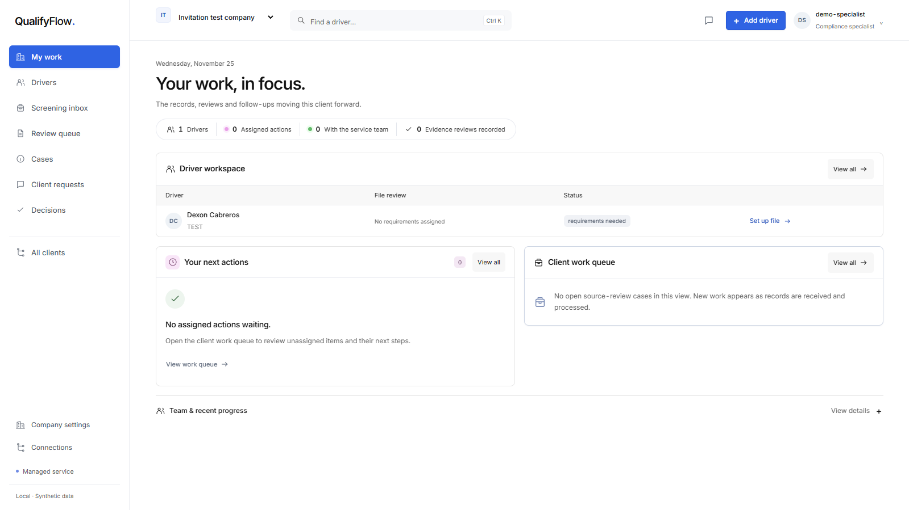
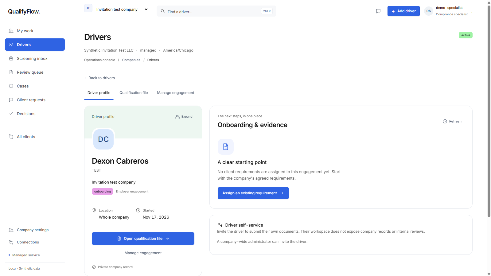

# QualifyFlow

A driver qualification operations platform: onboarding, requirements, evidence, case review, and decisions in one workspace, replacing spreadsheets and manual follow-up.



> **Status:** under active implementation. Runs on **synthetic development data only**. No legal qualification determination and no production-readiness claim is made. See [Project status](#project-status).

## What it does

QualifyFlow gives a managed-service team and its client companies a shared, role-scoped workspace for qualifying drivers.

- **My work:** a specialist's daily view of assigned drivers, next actions, and the client work queue.
- **Drivers and engagements:** driver identities, employer engagements, and a per-driver profile with a qualification file.
- **Versioned requirements and evidence:** assign a company's agreed requirements to a driver and collect private, scanned evidence against them.
- **Intake:** CSV metadata import in place of manual entry, plus a screening inbox and review queue.
- **Cases and decisions:** source-review cases and recorded administrative decisions.
- **Client requests:** approved in-app requests between client companies and the service team.
- **Access control:** company onboarding, MFA, invitations, and scoped staff assignments, so each person only sees the records they are assigned.



## Tech stack

| Layer | Technology |
| --- | --- |
| Frontend | React, TypeScript, Vite |
| Backend | FastAPI, SQLAlchemy |
| Database | PostgreSQL |
| Background work | Separate local workers (Redis) |
| Local email | SMTP catcher for invitations and MFA mail |

## Run it locally

Everything below runs on `127.0.0.1`. Use that address in the browser too. The backend only accepts requests from the origin set in `.env` (`PUBLIC_APP_ORIGIN`), and `localhost` and `127.0.0.1` count as different origins.

**1. Configure.** Copy `.env.example` to `.env` and set the database, Redis, SMTP, and secrets. Use `127.0.0.1` rather than `localhost` for hosts (some Windows setups resolve `localhost` to IPv6 first and hang).

**2. Start the supporting services.** The backend needs all three:

| Service | Default | Notes |
| --- | --- | --- |
| PostgreSQL | `127.0.0.1:55432` | Local instance in `.local/postgres` |
| Redis | `127.0.0.1:6379` | |
| SMTP catcher | `127.0.0.1:1025` | e.g. Mailpit (inbox at `:8025`). Invitation and MFA emails land here. |

```bash
# Postgres (data directory kept under .local/)
pg_ctl -D .local/postgres -o "-p 55432 -h 127.0.0.1" -l .local/postgres.log start
```

**3. Backend**

```bash
uv sync --project backend
cd backend
# run database migrations (see the local-development runbook), then:
uv run uvicorn app.main:app --reload
```

API docs: http://127.0.0.1:8000/docs

**4. Frontend**

```bash
cd frontend
npm ci
npm run dev
```

App: http://127.0.0.1:5173

**5. Sign in.** Prepared demo credentials live only in the git-ignored `.local/LOCAL_LOGIN.md`. Local invitation and MFA emails appear in the SMTP catcher's inbox.

> If sign-in hangs with no error, a supporting service is almost always down. The backend waits on Postgres, Redis, or the mail server instead of failing. Check ports `55432`, `6379`, and `1025`.

## Documentation

- [Local development](docs/runbooks/local-development.md)
- [Manual testing and login walkthrough](docs/runbooks/manual-testing.md)
- [Employee access guide](docs/runbooks/employee-view.md)
- [Specialist training (spreadsheet and manual flows)](docs/runbooks/specialist-training.md)
- [Implementation status](docs/implementation/IMPLEMENTATION_STATUS.md) and [current context](docs/implementation/CURRENT_CONTEXT.md)
- [Managed-product experience](docs/design/MANAGED_PRODUCT_EXPERIENCE.md) (screenshots and exact verification limits)
- Architecture decisions: `docs/decisions`
- Planning documents (source of truth): `01_QUALIFYFLOW_SOFTWARE_MASTER_PLAN.md`, `02_DESIGN_AND_MOTION_SYSTEM_v1.1.md`, `03_WORKFLOWS_AND_USER_JOURNEYS.md`, `04_SECURITY_COMPLIANCE_AND_DELIVERY.md`

## Project status

**Implemented:** persisted company onboarding, MFA and invitations, scoped staff assignments, driver identities and engagements, versioned requirements, private scanned evidence, CSV metadata intake, cases, administrative decisions, and approved in-app client requests. The client and employee workspaces use real scoped records.

**Still pending:** milestones M2 to M4 are partial. Provider/API connections, external correspondence and reminders, automation, production storage and release hardening, and complete milestone verification are not done.

**Known limits:**
- Synthetic data only; no production-readiness claim.
- The older full onboarding browser script needs its selectors updated for the current UI. Do not treat the configured CI as a passing full-product release gate.
- Docker Compose infrastructure is provided but unverified on the author's Docker-less host.
